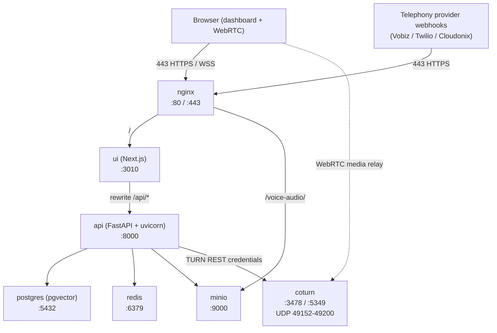
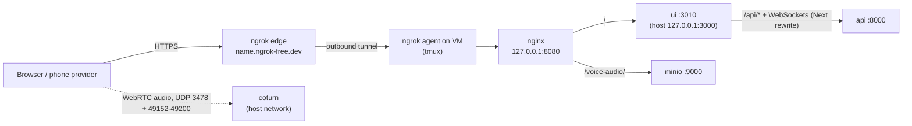
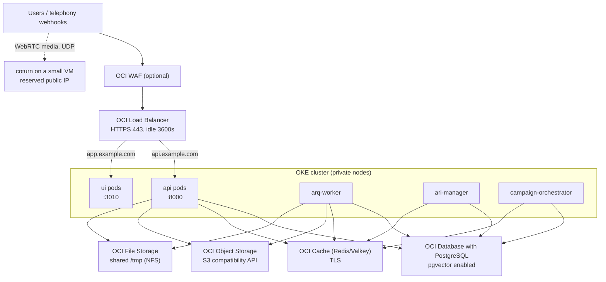

# Dograh AI — Oracle Cloud Infrastructure (OCI) Deployment Guide

This guide deploys the Dograh voice-agent platform on OCI. It follows the same
shape as the AWS ECS and Azure Container Apps guides in this folder, with two
paths:

| Path | What you get | Effort | Best for |
|---|---|---|---|
| **A. Compute instance + Docker Compose** | The upstream `docker-compose.yaml` (Postgres, Redis, SILO/MinIO storage, API, UI, nginx, coturn) on one VM | ~30 min | First deploy, demos, single-tenant production, OCI Always Free |
| **B. OKE / Container Instances + OCI managed services** | Split services, OCI Load Balancer, managed PostgreSQL/Redis, Object Storage, autoscaling | Hours to days | HA production, multiple tenants, ops team |

Start with **Path A**. It reuses the upstream `docker-compose.yaml` (the same
stack `scripts/setup_remote.sh` bootstraps, with production hardening layered on
top), and you can migrate to Path B later without changing application code.

---

## 1. What you are deploying



| Service | Image | Port | Persistence |
|---|---|---|---|
| `postgres` | `pgvector/pgvector:pg17` | 5432 (internal) | `postgres_data` volume |
| `redis` | `redis:7` | 6379 (internal) | `redis_data` volume |
| `minio` | `pgsty/silo` (see note) | 9000/9001 (internal) | `minio-data` volume |
| `api` | `ghcr.io/dograh-hq/dograh-api` | 8000 (loopback) | `shared-tmp` volume |
| `ui` | `ghcr.io/dograh-hq/dograh-ui` | 3010 (loopback) | none |
| `nginx` | `nginx:alpine` | 80, 443 | `./nginx.conf`, `./certs` |
| `coturn` | `coturn/coturn:4.8.0` | 3478, 5349, 49152-49200/udp | `./turnserver.conf` |
| `cloudflared` | `cloudflare/cloudflared` | 2000 (metrics) | optional, profile `tunnel` |

Notes that matter on OCI:

- The OSS `api` container runs **four processes in one container** via
  `scripts/start_services_dev.sh`: uvicorn (with `--reload`), the ARQ worker,
  the ARI manager and the campaign orchestrator. That is why the OSS compose has
  no separate worker services. Path B splits them.
- The app is **stateful per API process** (live calls and WebRTC sessions are
  held in memory). Do not run multiple `api` replicas behind a plain
  round-robin load balancer without session affinity.
- HTTPS is **mandatory**: browsers only grant microphone access
  (`getUserMedia`) on secure origins. A self-signed certificate works but
  requires a browser warning click; a real domain is strongly recommended.
- WebRTC needs **UDP** reachability to coturn. If UDP is blocked, calls connect
  but have no audio.
- **MinIO image:** the upstream compose pins `image: minio/minio`, but MinIO's
  community image is no longer anonymously pullable (Docker Hub returns 404;
  Quay requires AIStor credentials). The OCI override defaults to
  **SILO** (`pgsty/silo`), the maintained fork of the open-source MinIO server
  (renamed from `pgsty/minio` in August 2026). It keeps the entrypoint,
  `MINIO_*` env vars, `/minio/*` health routes and on-disk format, ships
  `curl` + `mcli`, and is published for amd64 and arm64. Pin a release tag
  (e.g. `RELEASE.2026-10-18T00-00-00Z`) rather than `latest`; set
  `MINIO_IMAGE` to your own authenticated image or move to OCI Object Storage
  (Path B) to drop the container entirely.
- **Storage bucket:** the API creates the `voice-audio` bucket on first use and
  installs an **anonymous read/write policy** so unsigned browser upload and
  download URLs work. Do not treat that bucket as private on Path A; put it
  behind the nginx `/voice-audio/` route only, and use OCI Object Storage with
  presigned URLs (Path B) if you need access control per object.
- **Database:** migrations run automatically in the `api` container
  (`scripts/start_services_dev.sh` → `alembic upgrade head`), including
  `CREATE EXTENSION IF NOT EXISTS vector` for pgvector. No manual SQL is
  needed on Path A.

---

## 2. Path A — Single Compute instance + Docker Compose

### A0. Sizing and region

| Item | Recommendation |
|---|---|
| Shape | `VM.Standard.A1.Flex` (ARM, Ampere) — **4 OCPU / 24 GB** is inside the OCI Always Free tier |
| Alternative | `VM.Standard.E5.Flex` — 4 OCPU / 16-24 GB if you want x86 or A1 capacity is unavailable |
| Boot volume | **150 GB** (default 50 GB is too small for Docker images + MinIO audio + logs) |
| Image | Oracle Linux 9 (aarch64/x86_64) or Ubuntu 24.04 |
| Region | Closest to your users **and** your telephony provider; Always Free resources only exist in your home region |

Both published images are multi-arch (`linux/amd64` **and** `linux/arm64`), so
`VM.Standard.A1.Flex` can pull them directly — no local build required.

If the console reports **"Out of host capacity"** for A1, retry a different
availability domain, or fall back to `VM.Standard.E5.Flex`. A1 capacity is
frequently exhausted in popular regions.

### A1. Network (VCN, subnet, NSG)

Create (Console → **Networking → Virtual Cloud Networks → Create VCN**):

1. VCN `dograh-vcn`, CIDR `10.0.0.0/16`.
2. Public subnet `dograh-public` — choose **Regional**, not a single availability
   domain (an AD-specific subnet pins instances to that AD) — CIDR `10.0.1.0/24`.
3. Internet Gateway `dograh-igw` + route rule `0.0.0.0/0 → dograh-igw`.
4. Network Security Group `dograh-nsg` with the rules below, attached to the
   instance's VNIC.

> **The route rule goes on the subnet's route table, not on the gateway.**
> Open **VCN → Resources → Route Tables → Default Route Table for dograh-vcn**
> (the table the `dograh-public` subnet uses) and add `0.0.0.0/0` with target
> type **Internet Gateway** → `dograh-igw`. If you used **Create VCN with
> Internet Connectivity**, this rule already exists.
>
> Two things cause `Rules in the route table must use private IP as a target`:
>
> 1. You are on **Internet Gateway → dograh-igw → Route Table** — that is the
>    gateway's *ingress* table, and it only accepts private-IP targets.
> 2. You associated a route table with the gateway when creating it (the
>    optional **Route Table Association** field). OCI then treats that **same**
>    table as an ingress table and rejects an Internet Gateway target. Fix:
>    create a separate **`dograh-public-rt`** with the `0.0.0.0/0 → dograh-igw`
>    rule, then **Subnet → dograh-public → Edit → Route Table** →
>    `dograh-public-rt`. Leave the gateway's table in place — once associated,
>    a gateway table can only be replaced, not removed.

Ingress rules for `dograh-nsg` (egress: allow all):

| Source | Protocol | Destination port | Why |
|---|---|---|---|
| Your admin IP | TCP | 22 | SSH |
| `0.0.0.0/0` | TCP | 80 | ACME HTTP-01 + HTTP→HTTPS redirect |
| `0.0.0.0/0` | TCP | 443 | UI, API, WebSockets |
| `0.0.0.0/0` | TCP + UDP | 3478 | TURN |
| `0.0.0.0/0` | TCP + UDP | 5349 | TURN over TLS (only if enabled) |
| `0.0.0.0/0` | UDP | 49152-49200 | TURN relay range |

Do **not** open 5432, 6379, 8000, 9000, 9001 or 3010. The compose network is
private and nginx is the only intended entry point.

> OCI security lists and NSGs are additive: leaving the default security list
> in place (SSH/ICMP) is fine, the NSG rules above just add to it.

#### Two ways to finish Path A

From here Path A splits into two variants. Sections A2 and A3 are shared.

| Variant | What runs | Public entry point | Needs a domain? | Sections |
|---|---|---|---|---|
| **1. Build from source + ngrok** (the deployment we actually ran) | **Your fork** (`saurabhkumar9901/AI-Voice-Calling-Agent`) built on the VM with `docker-compose-ecs.yaml` + `docker-compose.ngrok.yaml`, plus nginx and coturn | ngrok static domain (`https://<name>.ngrok-free.dev`) | No | A2, A3, **N1–N12** |
| **2. Upstream images + custom domain** | Upstream `dograh-hq` images from GHCR with `docker-compose.oci.yaml` | Your domain + Let's Encrypt on nginx 80/443 | Yes | A2, A3, A4–A9 |

Use **Variant 1** if you have code changes in your fork (custom services such as
`foir-service`, modified API/UI) or no domain. Variant 2 pulls the stock
Dograh images, so your fork's changes would **not** be included.

**Ingress rules for Variant 1 (ngrok).** ngrok makes an *outbound* connection,
so the UI needs **no** inbound port. Only SSH and TURN must be open:

| Source | Protocol | Destination port | Why |
|---|---|---|---|
| Your admin IP (or `0.0.0.0/0`) | TCP | 22 | SSH |
| `0.0.0.0/0` | TCP + UDP | 3478 | TURN (call audio) |
| `0.0.0.0/0` | UDP | 49152-49200 | TURN relay range (call audio) |

Ports 80/443 are only needed for Variant 2. Never open 3000, 3010, 8000, 8080,
9000 or 9001 in either variant.

Optional, reproducible provisioning from **OCI Cloud Shell** (no local CLI
needed):

```bash
export C=<compartment-ocid>
export T=<tenancy-ocid>
export AD=$(oci iam availability-domain list -c "$T" --query 'data[0].name' --raw-output)

VCN=$(oci network vcn create -c "$C" --cidr-blocks '["10.0.0.0/16"]' \
  --display-name dograh-vcn --dns-label dograh \
  --wait-for-state AVAILABLE --query 'data.id' --raw-output)

IGW=$(oci network internet-gateway create -c "$C" --vcn-id "$VCN" --is-enabled true \
  --display-name dograh-igw --wait-for-state AVAILABLE --query 'data.id' --raw-output)

RT=$(oci network route-table create -c "$C" --vcn-id "$VCN" --display-name dograh-rt \
  --route-rules "[{\"destination\":\"0.0.0.0/0\",\"networkEntityId\":\"$IGW\"}]" \
  --wait-for-state AVAILABLE --query 'data.id' --raw-output)

SL=$(oci network security-list create -c "$C" --vcn-id "$VCN" --display-name dograh-sl \
  --egress-security-rules '[{"protocol":"all","destination":"0.0.0.0/0","isStateless":false}]' \
  --ingress-security-rules '[
    {"protocol":"6","source":"0.0.0.0/0","isStateless":false,"tcpOptions":{"destinationPortRange":{"min":80,"max":80}}},
    {"protocol":"6","source":"0.0.0.0/0","isStateless":false,"tcpOptions":{"destinationPortRange":{"min":443,"max":443}}},
    {"protocol":"6","source":"0.0.0.0/0","isStateless":false,"tcpOptions":{"destinationPortRange":{"min":3478,"max":3478}}},
    {"protocol":"17","source":"0.0.0.0/0","isStateless":false,"udpOptions":{"destinationPortRange":{"min":3478,"max":3478}}},
    {"protocol":"6","source":"0.0.0.0/0","isStateless":false,"tcpOptions":{"destinationPortRange":{"min":5349,"max":5349}}},
    {"protocol":"17","source":"0.0.0.0/0","isStateless":false,"udpOptions":{"destinationPortRange":{"min":5349,"max":5349}}},
    {"protocol":"17","source":"0.0.0.0/0","isStateless":false,"udpOptions":{"destinationPortRange":{"min":49152,"max":49200}}}
  ]' --wait-for-state AVAILABLE --query 'data.id' --raw-output)

SUBNET=$(oci network subnet create -c "$C" --vcn-id "$VCN" --cidr-block 10.0.1.0/24 \
  --display-name dograh-public --route-table-id "$RT" \
  --security-list-ids "[\"$SL\"]" --dns-label pub \
  --wait-for-state AVAILABLE --query 'data.id' --raw-output)
```

### A2. Launch the instance

Console: **Compute → Instances → Create instance**.

- Image: **Oracle Linux 9** (or Ubuntu 24.04)
- Shape: `VM.Standard.A1.Flex`, 4 OCPU, 24 GB — note that the Always Free
  allowance is currently **2 OCPU / 12 GB** per month, so anything above that is
  billed (see *If the launch fails* below)
- Primary VNIC: the `dograh-public` subnet, NSG `dograh-nsg`, **public IPv4 = Yes**
  (if you used the CLI block above there is no NSG — the subnet already carries
  the equivalent `dograh-sl` security list, so nothing else is needed here)
- Boot volume: 150 GB, assign a backup policy
- **Initialization script**: paste the contents of
  [`guides/oci/cloud-init.sh`](oci/cloud-init.sh) — installs Docker + Compose,
  adds swap, opens the host firewall, creates `~/dograh`
- SSH key: your public key

CLI equivalent (run from a machine with the OCI CLI configured and this repo
checked out; in **OCI Cloud Shell**, upload `cloud-init.sh` first):

```bash
# Pick the newest platform image for the shape (names look like
# Oracle-Linux-9.5-2025.xx.xx-0-aarch64)
oci compute image list -c "$T" --operating-system "Oracle Linux" \
  --shape VM.Standard.A1.Flex \
  --query 'data[].{name:"display-name",id:id}' --output table
export IMG=<image-ocid>

oci compute instance launch -c "$C" --availability-domain "$AD" \
  --shape VM.Standard.A1.Flex --shape-config '{"ocpus":4,"memoryInGBs":24}' \
  --image-id "$IMG" --subnet-id "$SUBNET" --assign-public-ip true \
  --display-name dograh --hostname-label dograh \
  --ssh-authorized-keys-file ~/.ssh/id_ed25519.pub \
  --boot-volume-size-in-gbs 150 \
  --user-data-file guides/oci/cloud-init.sh \
  --wait-for-state RUNNING
```

Use `{"ocpus":2,"memoryInGBs":12}` instead to stay inside the Always Free
allowance — 4 OCPU / 24 GB is billed on a paid account and rejected on an
Always Free one.

**Reserve the public IP.** OCI ephemeral public IPs are released when the
instance is stopped, which silently breaks DNS *and* coturn's `external-ip`.
Console: **Instance → Attached VNICs → VNIC → Public IP → Unassign**, then
**Assign public IP → Reserved** (you can also pre-create one under
**Networking → Reserved public IPs** and assign it here). Note the address down.

#### If the launch fails: "Out of capacity for shape VM.Standard.A1.Flex"

Exact console error:

```
API Error: Out of capacity for shape VM.Standard.A1.Flex in availability domain AD-1.
Create the instance in a different availability domain or try again later. If you
specified a fault domain, try creating the instance without specifying a fault domain.
```

This is **not** a configuration mistake. Oracle simply has no free Ampere hosts
in that availability domain at the moment (very common on Always Free). The
VCN, subnet and NSG are fine and can be kept. Options, easiest first:

1. **Another availability domain.** In **Create instance → Placement**, switch
   AD-1 to AD-2/AD-3 and set the fault domain to **"Let Oracle choose the best
   fault domain"**.
   - If the AD dropdown is locked, the subnet is AD-specific. Create a
     **Regional** subnet (see the troubleshooting table).
   - Single-AD regions (for example **Mumbai `ap-mumbai-1`** and **Hyderabad
     `ap-hyderabad-1`**) have nothing to switch to: retry later or use the
     options below.
2. **Ask for a smaller shape.** 1 OCPU / 6 GB or 2 OCPU / 12 GB fits more
   often. Once the instance exists, **Edit → Shape** back to 4 OCPU / 24 GB
   (needs a reboot, and only succeeds if capacity exists at that moment).
3. **Retry automatically.** Capacity frees up in windows of seconds to minutes,
   at unpredictable times — there is no dependable "off-hours", and in Mumbai
   the window is contended around the clock. A failed launch creates nothing,
   so retrying is safe:

   ```bash
   export C=<compartment-ocid> T=<tenancy-ocid> SUBNET=<subnet-ocid> IMG=<aarch64-image-ocid>
   ADS=$(oci iam availability-domain list -c "$T" --query 'data[].name' --raw-output | jq -r '.[]')

   while true; do
     for AD in $ADS; do
       echo "$(date) trying $AD"
       if oci compute instance launch -c "$C" --availability-domain "$AD" \
           --shape VM.Standard.A1.Flex --shape-config '{"ocpus":4,"memoryInGBs":24}' \
           --image-id "$IMG" --subnet-id "$SUBNET" --assign-public-ip true \
           --display-name dograh --hostname-label dograh \
           --ssh-authorized-keys-file ~/.ssh/id_ed25519.pub \
           --boot-volume-size-in-gbs 150 --user-data-file cloud-init.sh; then
         echo "Launched in $AD"; break 2
       fi
     done
     sleep 120
   done
   ```

   Upload `cloud-init.sh` to Cloud Shell first. Cloud Shell disconnects after
   inactivity, so keep the tab active or run the loop from a PC with the OCI CLI.
   To run it unattended instead, see *Automating the hunt* below.

4. **Upgrade to Pay As You Go** (**Billing → Upgrade and Manage Payment**).
   Many users report paid accounts get A1 capacity far more easily (not
   guaranteed by Oracle). Always Free resources stay free after upgrading as
   long as you stay within the limits (2 OCPU / 12 GB A1, 200 GB block storage).
   Set a **budget alert** as a safety net.
5. **Use x86 instead (paid):** `VM.Standard.E5.Flex`, 4 OCPU / 16 GB, usually
   available immediately. The Dograh images and Dockerfiles work on both
   architectures; choose an x86_64 image instead of aarch64.

> Do **not** use the free `VM.Standard.E2.1.Micro` — 1 GB RAM is far too small
> for this stack. Always Free resources only exist in your **home region**, so
> switching regions does not help on the free tier.

#### Automating the hunt (GitHub Actions)

`scripts/hunt-a1.sh` does the retry loop for you from GitHub Actions, then
disables itself once it wins. It is a **poller, not a scheduler**: it never
destroys the instance afterwards, because getting it back is the hard part.

| File | Purpose |
|---|---|
| `scripts/a1.env` | Non-secret target config: region, AD, shape, image, subnet, NSG, cloud-init |
| `scripts/hunt-a1.sh` | Guard → launch → classify → notify loop |
| `scripts/main.tf`, `variables.tf`, `outputs.tf` | Terraform source of truth **after** the instance exists |
| `.github/workflows/a1-hunter.yml` | Self-chaining hunt; `7,37` cron only as a restart backstop |

Why not Vercel: Hobby crons fire **once per day** inside a one-hour window, and
per-minute crons need Pro ($20/mo) with a 300 s function cap. This repo is
public, so Actions minutes are free and the schedule can run as often as needed.

Setup:

1. Create an OCI API key (**Identity → Users → your user → API keys → Add API
   key → Paste public key**).
   > If `private.key` at the repo root is a live OCI signing key, rotate it: it
   > is committed to a **public** repository.
2. Add repository secrets (Settings → Secrets and variables → Actions):

   | Secret | Value |
   |---|---|
   | `OCI_CLI_USER` | user OCID |
   | `OCI_CLI_TENANCY` | tenancy OCID |
   | `OCI_CLI_FINGERPRINT` | API key fingerprint |
   | `OCI_CLI_KEY_CONTENT_B64` | `base64 -w0 oci_api_key.pem` |

3. Point `scripts/a1.env` at your image, subnet and NSG OCIDs (the defaults are
   the Mumbai ones this guide uses).
4. Actions → **a1-hunter** → **Run workflow** with `dry_run` ticked to verify
   auth and the guard, then start it for real once without `dry_run`.

**The schedule does not carry the hunt.** GitHub's `schedule` trigger is
best-effort and, for a newly added workflow, is routinely queued hours late or
dropped outright — it has been observed firing zero times in an hour. So each
run that does not win queues its own successor through `workflow_dispatch` (the
one event `GITHUB_TOKEN` is allowed to raise), and the hunt becomes continuous:
roughly 7 minutes of attempts, a short gap, then the next run. The `7,37` cron
is only a backstop that restarts the chain if it ever dies.

Practical consequences:

- A single run is not the end of the hunt. Each one queues the next; nothing
  else needs to be running.
- `gh run list -w a1-hunter.yml` shows a steady stream of `workflow_dispatch`
  runs about every 10 minutes. That is the chain, not someone clicking.
- If a run is rate-limited by OCI (`429`), it queues its successor with a
  longer gap instead of hammering the API in place.

To stop it: **Actions → a1-hunter → Disable workflow** (or
`gh workflow disable a1-hunter.yml`). A winning run disables it automatically,
and the chain step refuses to queue a successor once the hunt has won.

The loop retries only on `OutOfHostCapacity`. Auth failures, tenancy limits and
invalid parameters fail the run and open an issue — silently retrying a broken
config is how this kind of automation wastes a week while looking healthy.
Those runs do **not** queue a successor, so a broken configuration stops the
hunt instead of looping on it.

Every `oci` call is made with `--no-retry`. Without it the SDK treats
`Out of host capacity` (a `500`) as retryable and silently re-sends the request
for ~110 seconds, which both wastes the run's attempt budget and multiplies the
request count against OCI's per-user rate limit — the cause of spurious `429`s.
With `--no-retry` a capacity rejection returns in ~3 seconds.

When it wins it prints the OCID and public IP, and disables the workflow. Adopt
it into Terraform:

```bash
cd scripts
terraform init
terraform import oci_core_instance.generated_oci_core_instance <instance-ocid>
terraform plan
```

`main.tf` sets `prevent_destroy` deliberately: one `terraform destroy` costs the
instance, and the capacity lottery starts over.

> **Shape size.** The Always Free A1 allowance is currently **2 OCPU / 12 GB**
> per month. `scripts/a1.env` asks for exactly that. Requesting 4 OCPU / 24 GB on
> an Always Free tenancy fails on the tenancy limit before capacity is even
> considered — and on a paid tenancy it is billed.

### A3. Host checks

```bash
ssh opc@<reserved-public-ip>        # Oracle Linux
ssh ubuntu@<reserved-public-ip>     # Ubuntu (the user for Ubuntu images is "ubuntu")
docker --version && docker compose version
sudo swapon --show
nproc && free -h                    # expect 4 CPUs / ~24 GB on A1.Flex
```

MobaXterm or any SSH client works the same way: host = reserved public IP,
user = `ubuntu` (or `opc`), key = the private key matching the public key you
gave OCI.

If you did not use the cloud-init script, install Docker manually and open the
firewall — see `cloud-init.sh` for the exact commands. Common OCI gotcha:
**Oracle Linux 9 ships firewalld enabled**, so ports opened in the NSG still
appear closed until `firewall-cmd` rules are added. **Oracle's Ubuntu images
ship iptables rules that reject everything except SSH** (see N5).

#### A3.1 Installing Docker + Compose on Ubuntu (if cloud-init did not run)

Symptoms that Docker or the Compose v2 plugin is missing:

```text
$ docker compose -f docker-compose-ecs.yaml up -d --build
unknown shorthand flag: 'f' in -f        # docker exists, but the "compose" plugin does not

$ docker compose version
Command 'docker' not found, but can be installed with:
sudo apt install docker.io               # do NOT install this one
sudo apt install podman-docker           # or this one
```

Install Docker's **official** packages (works on arm64 and x86_64; the example
VM ran Ubuntu 22.04 "jammy"):

```bash
# 1. Remove distro packages if present (keeps images/volumes in /var/lib/docker)
sudo apt-get remove -y docker.io docker-compose docker-compose-v2 podman-docker containerd runc 2>/dev/null

# 2. Add Docker's apt repository (these two commands print nothing on success)
sudo apt-get update
sudo apt-get install -y ca-certificates curl
sudo install -m 0755 -d /etc/apt/keyrings
sudo curl -fsSL https://download.docker.com/linux/ubuntu/gpg -o /etc/apt/keyrings/docker.asc
sudo chmod a+r /etc/apt/keyrings/docker.asc
echo "deb [arch=$(dpkg --print-architecture) signed-by=/etc/apt/keyrings/docker.asc] https://download.docker.com/linux/ubuntu $(. /etc/os-release && echo $VERSION_CODENAME) stable" \
  | sudo tee /etc/apt/sources.list.d/docker.list > /dev/null

# 3. Install engine + Compose v2 + buildx (buildx is required for --build)
sudo apt-get update            # look for "download.docker.com ... jammy stable" with no errors
sudo apt-get install -y docker-ce docker-ce-cli containerd.io docker-buildx-plugin docker-compose-plugin

# 4. Start on boot, and allow your user to run docker without sudo
sudo systemctl enable --now docker
sudo usermod -aG docker $USER
newgrp docker

# 5. Verify
docker --version
docker compose version         # must be v2.24.4 or newer (needed for !override / !reset)
docker run --rm hello-world
```

Right after step 1, `docker` is gone (`Command 'docker' not found`). That is
expected until step 3 finishes. If `apt-get update` shows `NO_PUBKEY`, `404`
or `is not signed`, or `apt-get install` says `Unable to locate package
docker-ce`, the repository setup is wrong. Check it with
`cat /etc/apt/sources.list.d/docker.list`: it should contain `arch=arm64` (on
A1) and end with `ubuntu jammy stable` (or your release codename), then redo
step 2.

---

## Variant 1 — Build from source + ngrok (no domain)

This is the exact setup that was deployed and verified: the fork is cloned onto
the VM, built locally, and published through a static ngrok domain. It meets
these goals:

1. The app keeps running when the SSH session closes or your PC is off.
2. The UI is reachable by anyone over HTTPS.
3. Browser calls, phone calls and voice work.
4. ngrok is run by hand on the VM.



#### Why not run `docker-compose-ecs.yaml` on its own?

`docker-compose-ecs.yaml` was written for AWS ECS, where the load balancer,
TLS and secrets come from AWS. On a bare VM it has these gaps, which
`docker-compose.ngrok.yaml` fixes without touching the ECS file:

| Gap in `docker-compose-ecs.yaml` | Effect on a VM | Fixed by |
|---|---|---|
| No HTTPS (UI on plain `:3000`) | Browsers block the microphone on `http://<ip>`, so test calls fail | ngrok HTTPS |
| No coturn | The VM only knows its private `10.0.1.x` address; calls can connect with **no audio** on mobile/corporate networks | `coturn` service |
| UI `BACKEND_URL: http://api:8000` | The UI cannot hand that to the browser, so [`route.ts`](../ui/src/app/api/config/version/route.ts) falls back to `http://localhost:8000` and remote API calls fail | `BACKEND_URL=${PUBLIC_URL}` |
| `MINIO_PUBLIC_ENDPOINT: localhost:9000` | Uploads and recording playback break for remote users | nginx `/voice-audio/` + `sub_filter` |
| 8000, 9000, 9001, 3000 published on all interfaces | Docker bypasses the host firewall | rebinds to `127.0.0.1` |
| No `restart:` policy | Containers stay down after a crash or reboot | `restart: unless-stopped` |
| `pgsty/minio` image | Renamed upstream | `pgsty/silo` |
| `TURN_HOST=localhost` in `api/.env` | API tells browsers to use a TURN server on *their own PC* | `TURN_HOST=${PUBLIC_IP}` |

Files involved (all in the repo except the two generated on the VM):

| File | Purpose |
|---|---|
| [`docker-compose-ecs.yaml`](../docker-compose-ecs.yaml) | Base services: postgres, redis, minio, api, ari-manager, campaign-orchestrator, arq-worker, ui, foir-service (all built from source) |
| [`docker-compose.ngrok.yaml`](../docker-compose.ngrok.yaml) | Override: restart policies, loopback-only ports, public URL/TURN env for all API-image services, nginx, coturn |
| [`nginx/ngrok.conf`](../nginx/ngrok.conf) | Plain-HTTP front door for ngrok (ngrok terminates TLS) with `/voice-audio/` and MinIO URL rewriting |
| `api/.env` | Your existing API settings (gitignored, copied from your PC) |
| `.env` (repo root, **generated on VM**) | `PUBLIC_URL`, `PUBLIC_IP`, `PRIVATE_IP`, `TURN_SECRET` for compose interpolation |
| `turnserver.conf` (repo root, **generated on VM**) | coturn config with the TURN secret (gitignored) |

### N1. Clone the repository

```bash
cd ~
git clone https://github.com/saurabhkumar9901/AI-Voice-Calling-Agent.git
cd ~/AI-Voice-Calling-Agent        # = /home/ubuntu/AI-Voice-Calling-Agent
```

- `pipecat/` is committed as normal files in this fork (not a submodule), so
  `--recursive` is **not** needed.
- If the repository is **private**, use a GitHub Personal Access Token as the
  password when prompted.
- Because the folder is `AI-Voice-Calling-Agent`, the compose project name is
  `ai-voice-calling-agent` and the Docker network is
  **`ai-voice-calling-agent_app-network`** (check with `docker network ls`).

### N2. Copy `api/.env` to the VM

`api/.env` is gitignored, so it is not in the clone, but every API-image
service in `docker-compose-ecs.yaml` requires it (`env_file: api/.env`).
From your **Windows PC** (PowerShell):

```powershell
scp "d:\dograh 19-08\dograh\api\.env" ubuntu@<public-ip>:~/AI-Voice-Calling-Agent/api/.env
```

(MobaXterm users can also drag the file into the SFTP side panel.)

What matters inside `api/.env` on the VM:

| Variable | Action | Why |
|---|---|---|
| `BACKEND_API_ENDPOINT` (e.g. an old ngrok URL from your PC) | Nothing to do — the override sets it to `PUBLIC_URL` | Used to build the **telephony webhook and media WebSocket URLs** ([`common.py`](../api/utils/common.py)) and call-report links. It does **not** affect the browser; the UI's `BACKEND_URL` wins |
| `TURN_HOST=localhost` | Overridden to `PUBLIC_IP`. Comment it out if you ever run the ECS file **without** the override | `localhost` tells browsers to use a TURN server on their own machine |
| `DATABASE_URL`, `REDIS_URL`, `MINIO_ENDPOINT`, `LOG_LEVEL` (with `localhost`) | Leave as is | Overridden by the `environment:` block in `docker-compose-ecs.yaml` |
| `UI_APP_URL=http://localhost:3000` | Overridden to `PUBLIC_URL` | Used for links |
| Your provider keys (Gemini, etc.) | Keep | Loaded into the API containers |
| `OSS_JWT_SECRET` | **Add it** on the VM: `echo "OSS_JWT_SECRET=$(openssl rand -hex 32)" >> api/.env` | Not set anywhere else; the code default `change-me-in-production` is public, so anyone could forge login tokens |

`environment:` in compose always wins over `env_file:`, which is why the
`localhost` values are harmless.

### N3. Get the override files

`docker-compose.ngrok.yaml` and `nginx/ngrok.conf` are committed to the repo.
If you cloned before they were pushed:

```bash
cd ~/AI-Voice-Calling-Agent && git pull
```

### N4. OCI ingress rules and reserved IP

In the VCN **Security List** (or the `dograh-nsg` NSG) add ingress, source
`0.0.0.0/0`:

- TCP + UDP **3478**
- UDP **49152-49200**

Do **not** open 3000/8000/8080 — ngrok is outbound-only. Make sure the public
IP is **reserved** (A2): TURN advertises it, so it must not change.

### N5. Open the same ports in the VM's iptables (Ubuntu)

Oracle's Ubuntu images reject all inbound traffic except SSH at the host level,
even when the security list allows it. coturn uses host networking, so it
needs these rules:

```bash
sudo iptables -I INPUT -p udp --dport 3478 -j ACCEPT
sudo iptables -I INPUT -p tcp --dport 3478 -j ACCEPT
sudo iptables -I INPUT -p udp --dport 49152:49200 -j ACCEPT
sudo apt-get install -y iptables-persistent && sudo netfilter-persistent save
```

(On Oracle Linux use `firewall-cmd` instead — `cloud-init.sh` already does it.)

### N6. Create the root `.env` and `turnserver.conf`

Both files go in the **repo root on the VM**, next to `docker-compose-ecs.yaml`.
This is a **second** `.env`, separate from `api/.env`:

| File | Full path on the VM |
|---|---|
| Root `.env` | `/home/ubuntu/AI-Voice-Calling-Agent/.env` |
| `turnserver.conf` | `/home/ubuntu/AI-Voice-Calling-Agent/turnserver.conf` |

```
/home/ubuntu/AI-Voice-Calling-Agent/
├── .env                        ← NEW (PUBLIC_URL, PUBLIC_IP, PRIVATE_IP, TURN_SECRET)
├── turnserver.conf             ← NEW (coturn config)
├── docker-compose-ecs.yaml
├── docker-compose.ngrok.yaml
├── nginx/
│   └── ngrok.conf
├── api/
│   └── .env                    ← copied in N2 (leave as is)
└── ui/
```

- Docker Compose automatically reads `.env` from the folder you run it in and
  uses it to fill `${PUBLIC_URL}`, `${PUBLIC_IP}` and `${TURN_SECRET}` in the
  override.
- The override mounts `./turnserver.conf` from the same folder.
- `api/.env` is unrelated; only the API containers load it.

Run this **from the repo root** (replace the ngrok domain with yours):

```bash
cd /home/ubuntu/AI-Voice-Calling-Agent

cat > .env <<EOF
PUBLIC_URL=https://willian-conditional-semistiffly.ngrok-free.dev
PUBLIC_IP=$(curl -s https://ifconfig.me)
PRIVATE_IP=$(ip -4 route get 1.1.1.1 | awk '{print $7}')
TURN_SECRET=$(openssl rand -hex 32)
EOF
chmod 600 .env
set -a; . ./.env; set +a

cat > turnserver.conf <<EOF
listening-port=3478
min-port=49152
max-port=49200
external-ip=${PUBLIC_IP}/${PRIVATE_IP}
relay-ip=${PRIVATE_IP}
realm=dograh
use-auth-secret
static-auth-secret=${TURN_SECRET}
fingerprint
no-tls
no-dtls
no-cli
no-multicast-peers
log-file=stdout
EOF

cat .env      # PUBLIC_IP = reserved public IP, PRIVATE_IP = 10.0.x.x
ls -la .env turnserver.conf
```

Never create these on your PC or push them: both hold the TURN secret and are
in `.gitignore`. Do not regenerate `TURN_SECRET` casually — if you do,
regenerate `turnserver.conf` too and recreate the stack (N8).

`ui/.env` on your PC is not used by Docker (the UI Dockerfile does not copy
it), so ignore it here.

### N7. Install ngrok and run it in tmux

```bash
curl -sSL https://ngrok-agent.s3.amazonaws.com/ngrok.asc | sudo tee /etc/apt/trusted.gpg.d/ngrok.asc >/dev/null
echo "deb https://ngrok-agent.s3.amazonaws.com bookworm main" | sudo tee /etc/apt/sources.list.d/ngrok.list
sudo apt-get update && sudo apt-get install -y ngrok tmux
ngrok config add-authtoken <your-authtoken>     # dashboard.ngrok.com → Your Authtoken
```

**Stop ngrok on your PC first.** A free static domain can only be online from
one agent at a time.

```bash
tmux new -s ngrok
ngrok http --url=https://willian-conditional-semistiffly.ngrok-free.dev 8080
```

Expected output:

```text
Session Status    online
Forwarding        https://willian-conditional-semistiffly.ngrok-free.dev -> http://localhost:8080
```

Detach with **Ctrl+B, then D**. ngrok keeps running in the background.

| tmux command | What it does |
|---|---|
| `tmux ls` | List sessions (must show `ngrok: 1 windows ...`) |
| `tmux attach -t ngrok` | Re-open the ngrok screen |
| Ctrl+B, then D | Detach (leave it running) |
| `pgrep -a ngrok` | Check the process is alive |

> If you start ngrok **directly in the SSH terminal (not in tmux)**, closing
> the terminal stops ngrok and the site goes offline with `ERR_NGROK_3200`.

### N8. Build and start the stack

```bash
cd ~/AI-Voice-Calling-Agent
docker compose version        # v2.24.4+ required for !override

D="docker compose -f docker-compose-ecs.yaml -f docker-compose.ngrok.yaml"
$D up -d --build
$D ps
```

- The first build on A1 (ARM) takes **~15–30 minutes**, mostly installing
  CPU torch and pipecat. Watch it from a second SSH window with
  `$D logs -f api`.
- The API runs Alembic migrations on start; its healthcheck has a 180 s
  start period, so `api` shows `starting` for up to ~3 minutes.
- `ui` waits for `api` to be healthy; `nginx` waits for `ui` and `minio`.

Always pass **both** `-f` files, in this order, for every compose command
(`ps`, `logs`, `restart`, `down`, ...). The `D=...` alias saves typing.

### N9. Start on boot

```bash
sudo systemctl enable docker
```

(Output `Synchronizing state of docker.service with SysV service script...`
is normal.) Every container has `restart: unless-stopped`, so the whole stack
comes back after a crash or VM reboot. **ngrok in tmux does not** survive a
reboot — see N11.

### N10. Verify and open the site

On the VM, check each layer:

```bash
$D ps                                       # api healthy; ui, nginx, coturn running
curl -s  localhost:8000/api/v1/health       # API  → JSON
curl -sI localhost:3000 | head -1           # UI   → HTTP/1.1 200
curl -sI localhost:8080 | head -1           # nginx → HTTP/1.1 200
tmux attach -t ngrok                        # "Session Status online"  (Ctrl+B, D to leave)
```

Then open, from any device:

**`https://<your-name>.ngrok-free.dev`** (here:
`https://willian-conditional-semistiffly.ngrok-free.dev`)

- The free ngrok plan shows a "You are about to visit…" page first: click
  **Visit Site**.
- Test it on a phone using **mobile data** to prove it works without your PC
  or network.

First-use steps:

1. **Sign up** — creates the first account (local OSS auth, stored on the VM).
2. **Model Configurations** — add your LLM / STT / TTS keys.
3. Open an agent and start a **web call**; allow the microphone.
4. If you use Vobiz / Twilio / Cloudonix, point the provider's webhook at the
   same ngrok domain. It now reaches the VM instead of your PC.

### N11. Closing the SSH session (MobaXterm) and reboots

Before closing MobaXterm:

```bash
tmux ls                                                  # must show: ngrok: 1 windows ...
docker ps --format "table {{.Names}}\t{{.Status}}"       # containers Up / healthy
```

If both look right, close MobaXterm or turn your PC off.

| Component | Close MobaXterm / turn off PC | VM reboots |
|---|---|---|
| Docker containers | Keep running | Restart automatically (`restart: unless-stopped` + `systemctl enable docker`) |
| ngrok in tmux | Keeps running | **Stops** — SSH in and run N7's `tmux new -s ngrok` + `ngrok http ...` again |

**Optional: make ngrok survive reboots too** (replaces the tmux session).
Write the tunnel into the ngrok config:

```yaml
# /home/ubuntu/.config/ngrok/ngrok.yml
version: 3
agent:
  authtoken: <your-authtoken>
endpoints:
  - name: dograh
    url: https://willian-conditional-semistiffly.ngrok-free.dev
    upstream:
      url: 8080
```

```bash
tmux kill-session -t ngrok          # stop the manual agent first (same domain)
sudo ngrok service install --config /home/ubuntu/.config/ngrok/ngrok.yml
sudo ngrok service start
systemctl status ngrok --no-pager
```

### N12. Operate

**Update to the latest code from your fork**

```bash
cd ~/AI-Voice-Calling-Agent
git pull
$D up -d --build
docker image prune -f               # remove old image layers
```

The root `.env`, `turnserver.conf` and `api/.env` are gitignored, so `git pull`
never overwrites them.

**Logs and restarts**

```bash
$D logs -f --tail=100 api
$D logs --tail=50 ui nginx coturn
$D restart api
$D up -d --force-recreate api ari-manager campaign-orchestrator arq-worker   # after editing api/.env
```

**Disk** — builds are large. Check with `df -h` and `docker system df`; clean
with `docker builder prune -f`.

**Free ngrok plan limits**

- Browser visitors see ngrok's warning page once; telephony webhooks are not
  affected.
- There is a **monthly bandwidth cap**. Phone-call audio streams through ngrok
  (WebSocket media); browser-call audio does **not** (it goes over WebRTC/TURN
  directly). With heavy phone traffic, use a paid ngrok plan or Variant 2 with
  your own domain.
- One static domain, one online agent at a time.

#### Other ways to expose the UI (testing only)

**SSH tunnel — zero changes, only you can use it.** Run
`docker compose -f docker-compose-ecs.yaml up -d --build` (no override), then
on your PC:

```powershell
ssh -L 3000:localhost:3000 -L 8000:localhost:8000 -L 9000:localhost:9000 ubuntu@<public-ip>
```

Open `http://localhost:3000`. The browser treats `localhost` as secure, so the
mic works, and the `localhost:8000` / `localhost:9000` URLs the app hands out go
through the tunnel. It stops when the SSH session closes.

**Cloudflare quick tunnel — public HTTPS, random URL.**

```bash
docker run -d --name ui-tunnel --restart unless-stopped --network ai-voice-calling-agent_app-network \
  cloudflare/cloudflared:latest tunnel --no-autoupdate --url http://nginx:80
docker logs ui-tunnel 2>&1 | grep trycloudflare.com
```

Put that URL in `PUBLIC_URL` and recreate the stack. The URL changes every time
the tunnel restarts, so it is only good for quick tests.

**Opening port 3000 directly** gives plain HTTP: the dashboard loads but the
browser blocks the microphone. Not recommended.

#### Running the services without Docker

Possible (Python 3.12, Node 20, Postgres + pgvector, Redis, MinIO and ffmpeg on
ARM), but it gives no benefit: you still need HTTPS and TURN, and you lose the
restart policies. Use Docker.

---

## Variant 2 — Upstream images + custom domain (A4–A9)

### A4. DNS

Create an `A` record pointing your hostname at the reserved public IP:

```
voice.example.com.   A   203.0.113.10
```

Use OCI DNS (public zone) or any external provider. Verify with
`dig +short voice.example.com`. Do this **before** requesting the certificate;
Let's Encrypt validates over port 80.

### A5. Deploy the stack

First copy the OCI helper files to the instance (run this **on your
workstation**, from the repository root):

```bash
ssh opc@<reserved-public-ip> 'mkdir -p ~/dograh'
scp guides/oci/docker-compose.oci.yaml \
    guides/oci/nginx.conf.template \
    guides/oci/dograh.service \
    opc@<reserved-public-ip>:~/dograh/
```

Then configure and start everything on the VM:

> The override file uses the Compose `!reset` / `!override` YAML tags, so you
> need **Docker Compose v2.24.4+** (`docker compose version`). The cloud-init
> script installs the current plugin.

```bash
ssh opc@<reserved-public-ip>
cd ~/dograh

# 1. Upstream compose file
curl -fsSLO https://raw.githubusercontent.com/dograh-hq/dograh/main/docker-compose.yaml

# 2. Secrets + configuration
cat > .env <<EOF
REGISTRY=ghcr.io/dograh-hq
ENABLE_TELEMETRY=false

BACKEND_API_ENDPOINT=https://voice.example.com
# Public origin for the UI at runtime. The browser-side API client uses this
# value, so it must be reachable from outside (not api:8000). The /api rewrite
# itself is baked into the image and stays on http://api:8000 internally.
BACKEND_URL=https://voice.example.com
TURN_HOST=voice.example.com

# Replace with your reserved public IP
PUBLIC_IP=203.0.113.10

POSTGRES_PASSWORD=$(openssl rand -hex 24)
REDIS_PASSWORD=$(openssl rand -hex 24)
MINIO_IMAGE=pgsty/silo:RELEASE.2026-10-18T00-00-00Z
MINIO_ROOT_USER=dograh$(openssl rand -hex 4)
MINIO_ROOT_PASSWORD=$(openssl rand -hex 24)
OSS_JWT_SECRET=$(openssl rand -hex 32)
TURN_SECRET=$(openssl rand -hex 32)

# 0 = do not advertise turns:// (see the TURN notes). Set 5349 only if you
# configure coturn with a certificate.
TURN_TLS_PORT=0
EOF
chmod 600 .env

# 3. nginx config for the domain
sed 's/__DOMAIN__/voice.example.com/g' nginx.conf.template > nginx.conf
mkdir -p certs certbot/www

# 4. TURN config (uses TURN_SECRET and PUBLIC_IP from .env)
set -a; . ./.env; set +a
cat > turnserver.conf <<TURN
listening-port=3478
min-port=49152
max-port=49200
external-ip=${PUBLIC_IP}
realm=voice.example.com
use-auth-secret
static-auth-secret=${TURN_SECRET}
fingerprint
no-cli
no-multicast-peers
log-file=stdout
TURN

# 5. Temporary self-signed cert so nginx can boot before Let's Encrypt
openssl req -x509 -nodes -newkey rsa:2048 -days 1 \
  -keyout certs/local.key -out certs/local.crt \
  -subj "/CN=voice.example.com" \
  -addext "subjectAltName=DNS:voice.example.com"

# 6. First start (pulls multi-arch images from GHCR)
docker compose -f docker-compose.yaml -f docker-compose.oci.yaml \
  --profile remote up -d --pull always
```

The first boot runs Alembic migrations (which also enable the `vector`
extension) and downloads models; allow 2-5 minutes. The API healthcheck has a
180 s `start_period`. The `voice-audio` bucket is created when the API
initialises storage on first start (with the anonymous read/write policy
described in section 1). The override keeps `api`/`ui` bound to `127.0.0.1` only — nginx reaches
them over the compose network — and leaves `cloudflared` out unless you add
`--profile tunnel`.

> Keep `.env` and do not re-run step 2 on an existing install: it generates new
> DB/Redis/MinIO passwords, and the already-initialised volumes will reject
> them. To rotate deliberately, change the password and the volume together.

#### TURN notes

`external-ip` **must** be the reserved public IP, and `static-auth-secret` must
equal `TURN_SECRET` in `.env` — the API signs time-limited credentials with it.

TLS for TURN is optional. WebRTC media is already encrypted end-to-end with
DTLS-SRTP; TURN TLS only protects the relay leg. If you want it:

1. Add these lines to `turnserver.conf`:
   `tls-listening-port=5349`, `cert=/etc/coturn/certs/local.crt`,
   `pkey=/etc/coturn/certs/local.key`.
2. Put the certificate where coturn can read it (a small override file avoids
   editing the upstream compose):

   ```yaml
   # docker-compose.coturn-tls.yaml (optional)
   services:
     coturn:
       volumes:
         - ./certs:/etc/coturn/certs:ro
   ```

   and add `-f docker-compose.coturn-tls.yaml` to every compose command.
   `chmod 644` the key, or run coturn as root, or the process cannot read it.
3. Set `TURN_TLS_PORT=5349` in `.env` and restart `api` and `coturn`.

Otherwise leave `TURN_TLS_PORT=0` so the API does not hand out `turns:` URIs
that cannot connect.

### A6. HTTPS with Let's Encrypt

```bash
# Oracle Linux 9 ships certbot in EPEL; Ubuntu has it in universe.
sudo dnf install -y oracle-epel-release-el9 && sudo dnf install -y certbot
# Ubuntu: sudo apt-get install -y certbot

sudo certbot certonly --webroot \
  -w /home/opc/dograh/certbot/www \
  -d voice.example.com \
  --agree-tos -m you@example.com --no-eff-email

sudo cp /etc/letsencrypt/live/voice.example.com/fullchain.pem ~/dograh/certs/local.crt
sudo cp /etc/letsencrypt/live/voice.example.com/privkey.pem  ~/dograh/certs/local.key
sudo chmod 644 ~/dograh/certs/local.crt
sudo chmod 600 ~/dograh/certs/local.key      # nginx container runs as root

docker compose -f docker-compose.yaml -f docker-compose.oci.yaml \
  --profile remote restart nginx
```

Install a deploy hook so renewals are copied in and nginx is reloaded
automatically (`certbot`'s systemd timer runs twice a day):

```bash
sudo tee /etc/letsencrypt/renewal-hooks/deploy/dograh.sh >/dev/null <<'HOOK'
#!/bin/bash
set -e
cp /etc/letsencrypt/live/voice.example.com/fullchain.pem /home/opc/dograh/certs/local.crt
cp /etc/letsencrypt/live/voice.example.com/privkey.pem  /home/opc/dograh/certs/local.key
chmod 644 /home/opc/dograh/certs/local.crt
chmod 600 /home/opc/dograh/certs/local.key
cd /home/opc/dograh
docker compose -f docker-compose.yaml -f docker-compose.oci.yaml --profile remote restart nginx
HOOK
sudo chmod +x /etc/letsencrypt/renewal-hooks/deploy/dograh.sh
sudo certbot renew --dry-run
```

> `scripts/setup_custom_domain.sh` automates most of this, but it copies
> `archive/.../fullchain1.pem` — the `1` suffix changes after renewals. Prefer
> the `live/` paths above, or a symlink-free deploy hook like this one.

**IP-only alternative:** run `scripts/setup_remote.sh` and use a self-signed
certificate (`https://<ip>` with a browser warning). This is only good for
checking that the UI loads: browsers treat a page with a certificate error as
untrusted, and Chrome will usually refuse microphone access, so browser test
calls need a trusted certificate (Let's Encrypt, or a self-signed CA installed
in the browser/OS trust store).

### A7. Verify

```bash
D="docker compose -f docker-compose.yaml -f docker-compose.oci.yaml --profile remote"

$D ps
curl -fsS http://localhost:8000/api/v1/health          # direct, inside the VM
curl -fsS https://voice.example.com/api/v1/health      # through nginx -> ui -> api
curl -fsS https://voice.example.com/ | head            # UI HTML

$D logs -f --tail=100 api
$D logs --tail=50 coturn
```

`api` and `ui` are published on `127.0.0.1` only (the override rebinds them), so
`curl http://localhost:8000/...` works on the VM but `http://<public-ip>:8000`
must **not**. Only 80/443 and the TURN ports should answer from outside. The
SILO console on 9001 is loopback-only too — reach it with
`ssh -L 9001:localhost:9001 opc@<ip>` and log in with `MINIO_ROOT_USER` /
`MINIO_ROOT_PASSWORD` from `.env`.

Then open `https://voice.example.com`, create the first account (local OSS auth),
add an inference provider key under **Model Configurations**, and run a browser
test call. Upload a document and play back a recording to exercise the
`/voice-audio/` route, then check `docker compose logs nginx` for 4xx/5xx. If
audio is one-way or absent, see the troubleshooting table.

### A8. Start on boot

```bash
cd ~/dograh
sudo cp dograh.service /etc/systemd/system/dograh.service
# Ubuntu: change User=opc and WorkingDirectory to /home/ubuntu/dograh
sudo systemctl daemon-reload
sudo systemctl enable --now dograh.service
sudo systemctl status dograh.service

sudo reboot   # verify the stack comes back by itself
```

`docker compose` services have no `restart:` policy upstream; the override file
adds `restart: unless-stopped`, and the systemd unit restarts everything after
a reboot.

### A9. Operate

**Upgrade**

```bash
cd ~/dograh
D="docker compose -f docker-compose.yaml -f docker-compose.oci.yaml --profile remote"

$D exec -T postgres pg_dump -U postgres postgres > backup-$(date +%F).sql
$D pull
$D up -d --remove-orphans
```

Migrations run automatically when the `api` container starts. To pin or roll
back, add a small override (GHCR tags look like `1.11.2`, without a `v`):

```yaml
# docker-compose.pin.yaml
services:
  api:
    image: ghcr.io/dograh-hq/dograh-api:1.11.2
  ui:
    image: ghcr.io/dograh-hq/dograh-ui:1.11.2
```

Then append `-f docker-compose.pin.yaml` to the compose command and run
`up -d`. Alembic migrations are forward-only: rolling the image back does not
downgrade the schema, so restore the matching Postgres backup instead if the
release contains a destructive migration.

**Backups**

- Assign a block-volume backup policy (Bronze or higher) to the boot volume.
- Nightly logical backup of Postgres (above) pushed to Object Storage with the
  OCI CLI (`oci os object put -bn dograh-backups --file backup.sql`) — run it
  from OCI Cloud Shell or a host with the CLI configured; create the bucket
  first. Back up `.env` separately (it holds the only copy of the secrets).
- MinIO audio lives in the `minio-data` volume on the boot volume; snapshot the
  volume before upgrades. For real retention, move to Object Storage (Path B).

**Monitoring**

- OCI Console → Instance → **Metrics**: enable the Compute Instance Monitoring
  plugin for memory/disk, and alarm on CPU > 80 %, disk > 80 %.
- Uptime check against `https://voice.example.com/api/v1/health`.
- Container logs are capped at 10 MB × 5 per container by the override file.
  Enable the OCI Logging agent only if you need centralised logs.

**Hardening checklist**

- [ ] Reserved public IP, DNS A record, valid certificate, renewal dry-run passed
- [ ] `OSS_JWT_SECRET`, DB/Redis/MinIO passwords rotated from defaults (done by `.env` above)
- [ ] 5432/6379 not published (override resets them); 8000/3010 bound to
      `127.0.0.1`; 9000/9001 already bound to localhost upstream
- [ ] NSG allows only 22/80/443/3478/5349/49152-49200
- [ ] `ENABLE_TELEMETRY=false` (or deliberately left on)
- [ ] `cloudflared`: not started on this path (the override moves it to the
      `tunnel` profile, because `BACKEND_API_ENDPOINT` already points at your
      domain). Only enable `--profile tunnel` if you deliberately want the
      public `trycloudflare.com` quick tunnel for webhook testing
- [ ] `/voice-audio/` exposed only through nginx; disk alarms set, because the
      bucket policy is anonymous read/write by design
- [ ] Block-volume backups + tested restore
- [ ] `.env` backed up somewhere safe (`chmod 600`, never in git)
- [ ] SSH restricted to your IP (or OCI Bastion)

**Scale up on one VM:** size up the shape (more OCPU/RAM) before adding API
replicas. The OSS `api` container runs a single uvicorn process with `--reload`,
so `FASTAPI_WORKERS` has no effect there, and multiple uvicorn workers would
split in-memory call state. For real horizontal scale, use Path B with sticky
sessions and a shared `/tmp`.

---

## 3. Path B — Production architecture on OCI



### B1. Images → OCIR

```bash
docker login <region>.ocir.io -u '<namespace>/<username>' --password-stdin <<< '<auth-token>'

docker build -t <region>.ocir.io/<namespace>/dograh-api:latest -f api/Dockerfile .
docker push <region>.ocir.io/<namespace>/dograh-api:latest

# UI: BACKEND_URL is baked into the Next.js rewrite config at build time.
docker build --build-arg BACKEND_URL=http://api:8000 \
  -t <region>.ocir.io/<namespace>/dograh-ui:latest -f ui/Dockerfile .
docker push <region>.ocir.io/<namespace>/dograh-ui:latest
```

Build the UI with the default `--build-arg BACKEND_URL=http://api:8000`: that
value is compiled into `routes-manifest.json`, so the UI proxies `/api/*` (and
WebSocket upgrades for `/api/v1/ws/*`) to the API service and the browser only
needs one public origin. Separately, set the UI's **runtime** `BACKEND_URL` to
the public origin (`https://app.example.com`): the browser-side API client and
the `/api/config/version` route use that value to build absolute URLs, and
`http://api:8000` is not reachable from a browser. The recommended topology
(B4) keeps browsers on the app origin and publishes `api.example.com` only for
telephony webhooks; if you instead make the API the browser-facing origin, use
that public URL for both the build arg and the runtime value (and allow for
CORS).

### B2. Managed data plane

**PostgreSQL — OCI Database with PostgreSQL**

- Create a database system in a private subnet (PostgreSQL 16/17).
- Create a **custom configuration with the `pgvector` extension enabled**
  (Extension Manager / configuration), otherwise `CREATE EXTENSION vector` is
  rejected.
- Connect as the admin user and create the app database/role once (the DSN
  below assumes both), then enable the extension in that database:
  `CREATE ROLE dograh LOGIN PASSWORD '...'; CREATE DATABASE dograh OWNER dograh;`
  then `\c dograh` and `CREATE EXTENSION IF NOT EXISTS vector;`
- DSN: `postgresql+asyncpg://dograh:<password>@<db-host>:5432/dograh?ssl=require`
  (asyncpg 0.30, pinned in `api/requirements.txt`, accepts the string form;
  note that `require` encrypts but does **not** verify the server certificate —
  use `ssl=verify-full` plus a CA file if you need verification)
- Allow 5432 only from the OKE node/pod subnet NSG.

**Redis — OCI Cache**

- Create a cluster in a private subnet with **TLS + auth token** enabled.
- DSN: `rediss://:<auth-token>@<primary-endpoint>:6379/0`
- OCI Cache presents a private CA. The app opens Redis with
  `redis.asyncio.from_url(REDIS_URL)` and default verification, so either mount
  the OCI CA bundle into the image and set `SSL_CERT_FILE` to it, or append
  `?ssl_cert_reqs=none` to the DSN (the cache is in a private subnet, so this is
  usually acceptable). The ARQ worker builds its own context with verification
  disabled (`api/tasks/arq.py`), so it connects either way.
- Redis is a hard dependency (ARQ queue + call state) — do not use an ephemeral
  container in production.

**Object Storage (optional, replaces MinIO)**

The backend's S3 client has no dedicated endpoint setting, so point boto3 at the
S3-compatible endpoint with standard AWS environment variables:

```env
ENABLE_AWS_S3=true
S3_BUCKET=dograh-voice-audio
S3_REGION=<oci-region>                 # e.g. ap-mumbai-1
AWS_ACCESS_KEY_ID=<customer-secret-key-access-key>
AWS_SECRET_ACCESS_KEY=<customer-secret-key-secret>
AWS_ENDPOINT_URL=https://<namespace>.compat.objectstorage.<oci-region>.oraclecloud.com
AWS_REQUEST_CHECKSUM_CALCULATION=when_required
AWS_RESPONSE_CHECKSUM_VALIDATION=when_required
```

Create the bucket yourself (the S3 backend does **not** auto-create it, unlike
MinIO), create the credentials under **Profile → Customer secret keys**, keep
the bucket private (downloads/upload use presigned URLs), and **test one upload
+ one download** before relying on it. The two checksum flags disable newer SDK
checksums that OCI's compatibility API rejects. If the S3 compatibility layer
gives you trouble, run SILO (`pgsty/silo`) on a block volume instead — it is the
supported default.

**Shared `/tmp` — OCI File Storage (NFS)**

`api` writes call audio/transcripts to `/tmp` and `arq-worker` reads them back
after the call. In Kubernetes that must be a **ReadWriteMany** volume: use OCI
File Storage mounted at `/tmp` on both. Block volumes are ReadWriteOnce and will
not work across pods/nodes.

### B3. Compute: OKE or Container Instances

**OKE (recommended for HA)**

- Create a **Basic** cluster (control plane is free; only worker nodes are billed).
- Node pool: 2-3 × `VM.Standard.E5.Flex` (4 OCPU / 16-24 GB), private subnet.
- Add the **OCI Native Ingress Controller** add-on if you want a single LB with
  host/path routing; otherwise expose each Service with
  `type: LoadBalancer` (one OCI LB per service — simpler, more expensive).
- Run Alembic as a one-off Job or initContainer, not in every API replica.

Split the monolithic container into the four roles (same image, different
commands):

| Deployment | Command |
|---|---|
| `api` | `uvicorn api.app:app --host 0.0.0.0 --port 8000` |
| `migrate` (Job, run once per release) | `alembic -c api/alembic.ini upgrade head` |
| `arq-worker` | `python -m arq api.tasks.arq.WorkerSettings --custom-log-dict api.tasks.arq.LOG_CONFIG` |
| `ari-manager` | `python -m api.services.telephony.ari_manager` |
| `campaign-orchestrator` | `python -m api.services.campaign.campaign_orchestrator` |
| `ui` | image default (`node server.js` on 3010) |

**OCI Container Instances** (no Kubernetes): each container instance gets a VCN
IP and can mount OCI File Storage for persistence. Put the API and UI behind an
OCI Load Balancer, run the three background roles as separate container
instances, and use managed Postgres/Redis/Object Storage. Good fit for a small
production deployment without a cluster to operate.

### B4. Edge: OCI Load Balancer

- Public flexible-shape LB in a public subnet; backends in a private subnet.
- **HTTPS listener (443)** with an OCI Certificates-managed certificate (no
  certbot). Redirect HTTP → HTTPS.
- **Idle timeout 3600 s** (max 7200) so long calls and WebSockets are not killed
  at the 60 s default.
- Backend sets: `api` → HTTP 8000, health check `GET /api/v1/health`;
  `ui` → HTTP 3010, health check `GET /`.
- Host-based routing rules: `api.example.com → api` (telephony webhooks,
  `BACKEND_API_ENDPOINT`), default / `app.example.com → ui`. Keep browsers on
  the app origin (the UI proxies `/api/*` to the API service) and set the UI's
  runtime `BACKEND_URL` to `https://app.example.com`; that avoids CORS and
  cross-origin cookies entirely.
- Enable **LB cookie session persistence** on the API backend set if you run
  more than one API replica (in-process call state).
- Optional: OCI WAF policy in front of the LB, and NSGs allowing 443 only from
  the WAF/LB.

TURN stays outside the LB: coturn needs UDP 3478 and the relay range
49152-49200. Run it on a small VM with the reserved public IP and
`external-ip=<that ip>`, or keep coturn on the Path A VM.

### B5. Secrets, networking, observability

- **OCI Vault** for DB/Redis/JWT/TURN secrets; inject via External Secrets
  Operator (OKE) or Container Instance secrets — never bake them into images.
- Private subnets for nodes/DB/cache; **NAT Gateway** for egress, **Service
  Gateway** for Object Storage (keeps traffic off the internet).
- **OCI Logging** (Fluent Bit on OKE) + **OCI Monitoring** alarms on LB 5xx,
  unhealthy backends, API latency, DB connections, CPU/disk.
- `ENVIRONMENT=production`, `LOG_TO_FILE=false`, JSON logs
  (`SERIALIZE_LOG_OUTPUT=true`) for structured ingestion.

---

## 4. Troubleshooting (OCI-specific)

| Symptom | Likely cause | Fix |
|---|---|---|
| `curl` to port 80/443 hangs | VCN security list **or** host firewall (firewalld on Oracle Linux) | Add NSG rules **and** `firewall-cmd` rules; verify from outside the VCN |
| Availability domain is fixed in the launch form (no dropdown) | The subnet is AD-specific instead of **Regional** | Create a new **Regional** subnet in the same VCN and launch there (an AD-specific subnet pins the instance to its AD) |
| `Rules in the route table must use private IP as a target` | You are editing the **Internet Gateway's** ingress route table, or the subnet's table is also associated with the gateway | Create **`dograh-public-rt`** (`0.0.0.0/0 → dograh-igw`) and assign it to `dograh-public` under **Subnet → Edit → Route Table**; leave the gateway's table alone |
| `502 Bad Gateway` on 443 | `api`/`ui` container not healthy, migration failed | `docker compose logs api`; wait for the 180 s start period; check DB credentials |
| `502` only after ~60 s of silence | LB idle timeout (Path B) | Set listener idle timeout to 3600 s |
| Browser refuses microphone | Not HTTPS / self-signed lockdown | Use a real domain + Let's Encrypt; self-signed works only after accepting the warning |
| Call connects, no audio | UDP 3478 or 49152-49200 blocked; wrong `external-ip` | Open UDP in NSG + firewalld; `external-ip` must be the **reserved** public IP |
| Browser calls work, but a **server-side** web call has no audio | `TURN_HOST` resolves to the public IP and the request never reaches coturn | Confirm coturn is up and 3478/49152-49200 are open; OCI routes in-VCN traffic to public IPs through the internet gateway, so hairpin itself is supported |
| `turns:...:5349` errors in logs | coturn has no certificate but the API advertises TLS | Set `TURN_TLS_PORT=0` (default in the override) or configure coturn certs |
| Audio/recording/transcript missing after a call | `api` and `arq-worker` not sharing `/tmp` (split deployments) | Mount the same OCI File Storage (NFS) at `/tmp` on both |
| Document upload fails, `ERR_CONNECTION_REFUSED` to `localhost:9000` | The browser got the raw internal MinIO URL (no rewrite) | Keep the nginx `/voice-audio/` route, `sub_filter`, and `proxy_set_header Accept-Encoding "";`; leave `MINIO_PUBLIC_ENDPOINT` unset (the app auto-uses `localhost:9000` and nginx rewrites it) |
| `exec format error` on A1 | Using a locally built amd64-only image | Use the multi-arch GHCR images or build with `--platform linux/arm64` |
| `pull access denied` / `not found` for `minio/minio` | MinIO community image removed from public registries | Keep the override's `MINIO_IMAGE=pgsty/silo:<release>` (the maintained fork), or set it to your own authenticated image |
| Compose error on `!reset` / `!override` | Docker Compose older than v2.24.4 | Upgrade the compose plugin (`docker compose version`); the port isolation in the override depends on those tags |
| `pgsty/silo` logs "unknown command" or restarts | You changed the image to a distroless/mis-tagged build | Use a `pgsty/silo:RELEASE.*` tag; the compose command `server /data --console-address ":9001"` must stay |
| Document upload returns 403/404 through the domain | `sub_filter` did not rewrite the MinIO URL (gzip body) or the route is missing | Keep `proxy_set_header Accept-Encoding "";` and the `/voice-audio/` location; `docker compose logs nginx` shows the request |
| A1 launch fails: "Out of capacity for shape VM.Standard.A1.Flex in availability domain AD-1" | No free Ampere hosts in that AD right now (not a config error) | Another AD with fault domain left to Oracle; smaller shape then resize; Cloud Shell retry loop or the GitHub Actions hunter; Pay As You Go upgrade; or `VM.Standard.E5.Flex` — see **A2 → If the launch fails** |
| Public IP changed after stop/start | Ephemeral public IP | Assign a **reserved** public IP, then update DNS and `turnserver.conf` |
| Disk full / containers restarting | 50 GB boot volume + Docker images + audio | Use 150 GB+, `docker system prune -af`, move audio to Object Storage |
| UI loads, but API calls fail against `http://localhost:8000` | UI runtime `BACKEND_URL` is the internal `http://api:8000`; the browser cannot reach it | Set `BACKEND_URL=https://voice.example.com` for the `ui` container (browser client) and leave the compiled rewrite target at `http://api:8000` |
| Certificate renewal broke the site | Certbot copied `fullchain1.pem` (stale after renew) | Copy from `/etc/letsencrypt/live/<domain>/` in the deploy hook |
| `unknown shorthand flag: 'f' in -f` on `docker compose -f ...` | The Docker Compose v2 plugin is not installed (distro `docker.io`) | Install Docker's official packages incl. `docker-compose-plugin` — **A3.1** |
| `Command 'docker' not found` right after removing `docker.io` | Old packages removed, new ones not installed yet | Finish A3.1 step 3. Do **not** install `docker.io` / `podman-docker` |
| `apt-get update`: `NO_PUBKEY` / `404` / `is not signed` for download.docker.com | Key download or repo line is wrong | Redo A3.1 step 2; `/etc/apt/sources.list.d/docker.list` must show your arch and codename |
| `Unable to locate package docker-ce` | Docker repo not added / `apt-get update` not run after adding it | Redo A3.1 steps 2–3 |
| `got permission denied while trying to connect to the Docker daemon socket` | User not in the `docker` group yet | `sudo usermod -aG docker $USER && newgrp docker` (or log out and back in) |
| `env file .../api/.env not found` | `api/.env` is gitignored and was not copied | `scp` it from your PC — **N2** |
| `required variable PUBLIC_URL is missing a value` | Root `.env` missing, or compose run from another folder | Create `/home/ubuntu/AI-Voice-Calling-Agent/.env` and run compose from that folder — **N6** |
| `pull access denied` for `pgsty/minio` | Image renamed | The ngrok override already uses `pgsty/silo`; when running the ECS file alone, change the image to `pgsty/silo` |
| Browser: `ERR_NGROK_3200` "endpoint … is offline" | No ngrok agent is connected for the domain (not started, started outside tmux and the SSH session closed, or VM rebooted) | `tmux ls` / `pgrep -a ngrok`; start it again in tmux — **N7** |
| ngrok: `ERR_NGROK_334` endpoint already online | The same domain is still running on your PC (or a second agent on the VM) | Stop the other agent, then retry |
| ngrok: `ERR_NGROK_4018` / authentication failed | No authtoken on the VM | `ngrok config add-authtoken <token>` |
| Browser: `ERR_NGROK_8012` / 502 | ngrok is up but nothing answers on 8080 | `curl -sI localhost:8080`; `$D ps` — nginx and ui must be running; `$D logs nginx ui` |
| Page loads but login / API calls fail (ngrok variant) | UI not using the public URL, or api unhealthy | `$D logs ui api`; check `PUBLIC_URL` in the root `.env` and recreate `ui` |
| Call connects but no audio (ngrok variant) | TURN not reachable | `$D logs coturn`; OCI ingress 3478 TCP/UDP + 49152-49200 UDP (N4); iptables rules (N5); `PUBLIC_IP`/`PRIVATE_IP` correct in `.env` and `turnserver.conf` |
| Site works only while MobaXterm is open | ngrok was started directly in the terminal | Run it inside `tmux` (N7) or as a service (N11) |

Useful commands (Variant 2):

```bash
docker compose -f docker-compose.yaml -f docker-compose.oci.yaml ps
docker compose -f docker-compose.yaml -f docker-compose.oci.yaml logs -f api
docker stats --no-stream
ss -lntup | grep -E ':(80|443|3478|5349|8000|3010)\b'
curl -vk https://voice.example.com/api/v1/health
```

Useful commands (Variant 1, run from `~/AI-Voice-Calling-Agent`):

```bash
D="docker compose -f docker-compose-ecs.yaml -f docker-compose.ngrok.yaml"
$D ps
$D logs -f --tail=100 api
docker stats --no-stream
ss -lntup | grep -E ':(3000|3478|8000|8080|9000)\b'   # 3000/8000/8080/9000 must show 127.0.0.1 only
curl -s localhost:8000/api/v1/health
tmux ls && pgrep -a ngrok
curl -sI https://willian-conditional-semistiffly.ngrok-free.dev | head -1
```

---

## 5. Cost sketch

- **Always Free path (Path A):** `VM.Standard.A1.Flex` 2 OCPU / 12 GB (the
  current Always Free allowance), up to 200 GB block volume, 10 TB/month
  outbound — enough for a small single-tenant deployment at effectively zero
  compute cost. A1 capacity is best-effort in the home region.
- **Paid Path A:** one flex VM + 150 GB boot volume + backups + egress. Cheapest
  production option.
- **Path B:** OKE basic control plane is free; you pay for worker nodes, the
  Load Balancer (per hour + bandwidth), managed PostgreSQL (OCPU/memory +
  storage), OCI Cache, Object Storage, WAF and egress. Check the OCI cost
  estimator for your region — prices vary by region and currency.

---

## 6. Go-live checklist

- [ ] Reserved public IP + DNS `A` record; TTL lowered before cutover
- [ ] Valid TLS certificate, auto-renewal dry-run passes, HSTS considered
- [ ] NSG: 22 restricted, 80/443 public, 3478/5349/49152-49200 UDP public
- [ ] `external-ip` in `turnserver.conf` equals the reserved public IP
- [ ] All default passwords and `OSS_JWT_SECRET` replaced; `.env` is `chmod 600`
- [ ] Real browser call tested from outside the VCN (not just localhost)
- [ ] Inbound telephony webhook tested from the provider (Vobiz/Twilio/Cloudonix)
- [ ] Backup + restore rehearsed; upgrade procedure documented
- [ ] Monitoring alarms (CPU, disk, health endpoint, LB 5xx) and log retention set
- [ ] `cloudflared` not running (it is opt-in via `--profile tunnel`); enable only if a provider needs the quick tunnel

**Variant 1 (build from source + ngrok)**

- [ ] Public IP is **reserved**; `PUBLIC_IP` in the root `.env` and `external-ip` in `turnserver.conf` match it
- [ ] OCI ingress: 22, 3478 TCP/UDP, 49152-49200 UDP only; iptables rules saved with `netfilter-persistent`
- [ ] `ss -lntup` shows 3000/8000/8080/9000/9001 on `127.0.0.1` only
- [ ] **`OSS_JWT_SECRET` set in `api/.env`.** Neither `docker-compose-ecs.yaml` nor the override sets it, and the code default is the public string `change-me-in-production` ([`constants.py`](../api/constants.py)), which lets anyone forge login tokens on a public site. Fix: `echo "OSS_JWT_SECRET=$(openssl rand -hex 32)" >> api/.env` then `$D up -d --force-recreate api ari-manager campaign-orchestrator arq-worker` (existing sessions are logged out)
- [ ] Root `.env`, `turnserver.conf` and `api/.env` are `chmod 600` and never committed
- [ ] Postgres/Redis/MinIO still use the ECS file's default passwords; acceptable only because they are not published outside the VM — keep it that way
- [ ] ngrok runs in tmux or as a service; ngrok on your PC is stopped
- [ ] `sudo systemctl enable docker` done; a `sudo reboot` test brings the containers back (then restart ngrok if it is in tmux)
- [ ] Browser call tested from a phone on mobile data; telephony webhook points at the ngrok domain
- [ ] Boot-volume backup policy assigned; `pg_dump` taken before big updates:
      `$D exec -T postgres pg_dump -U postgres postgres > backup-$(date +%F).sql`

---

## 7. Related files

| File | Purpose |
|---|---|
| [`guides/oci/cloud-init.sh`](oci/cloud-init.sh) | First-boot host prep (Docker, swap, firewall) |
| [`scripts/hunt-a1.sh`](../scripts/hunt-a1.sh) | A1 capacity hunter: retry loop, error classification, self-disable on success |
| [`scripts/a1.env`](../scripts/a1.env) | Non-secret target config for the hunter |
| [`scripts/main.tf`](../scripts/main.tf) | Terraform source of truth after the instance exists (`prevent_destroy`) |
| [`.github/workflows/a1-hunter.yml`](../.github/workflows/a1-hunter.yml) | Self-chaining hunt + `dry_run` dispatch; cron is only a restart backstop |
| [`guides/oci/docker-compose.oci.yaml`](oci/docker-compose.oci.yaml) | Variant 2: restart policies, log caps, credentials from `.env`, closes 5432/6379, binds 8000/3010 to loopback, swaps the object-storage image to SILO, makes `cloudflared` opt-in |
| [`guides/oci/nginx.conf.template`](oci/nginx.conf.template) | Variant 2: domain-based TLS reverse proxy with ACME webroot + `/voice-audio/` |
| [`guides/oci/dograh.service`](oci/dograh.service) | Variant 2: systemd unit so the stack survives reboots |
| [`docker-compose-ecs.yaml`](../docker-compose-ecs.yaml) | Variant 1 base: all services built from source |
| [`docker-compose.ngrok.yaml`](../docker-compose.ngrok.yaml) | Variant 1 override: restart policies, loopback ports, public URL + TURN env, nginx, coturn |
| [`nginx/ngrok.conf`](../nginx/ngrok.conf) | Variant 1: plain-HTTP front door for ngrok with `/voice-audio/` rewrite |

Upstream references: [`docs/deployment/docker.mdx`](../docs/deployment/docker.mdx),
[`docs/deployment/custom-domain.mdx`](../docs/deployment/custom-domain.mdx),
[`docs/developer/environment-variables.mdx`](../docs/developer/environment-variables.mdx).
